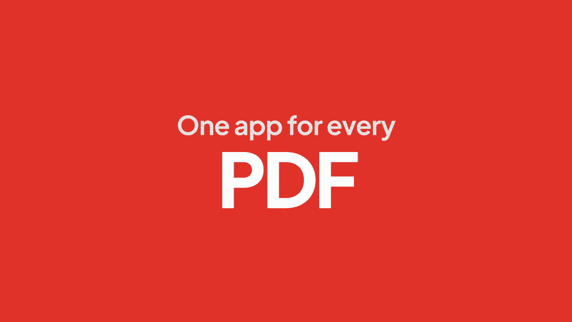
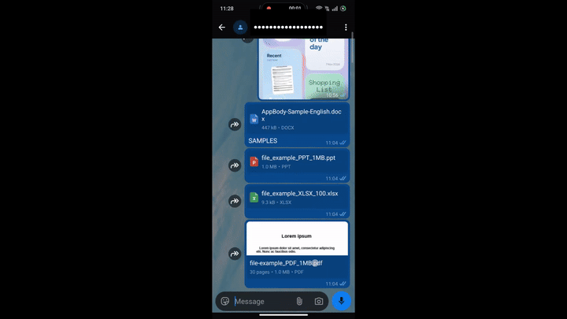
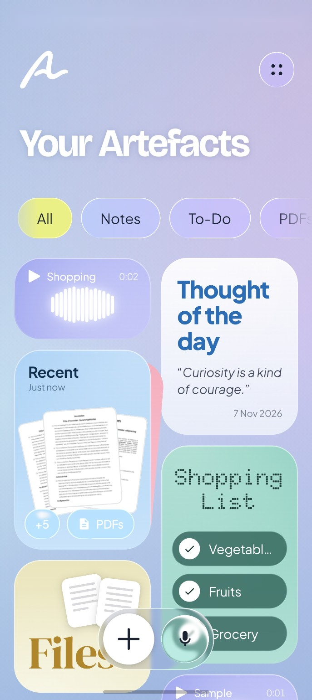
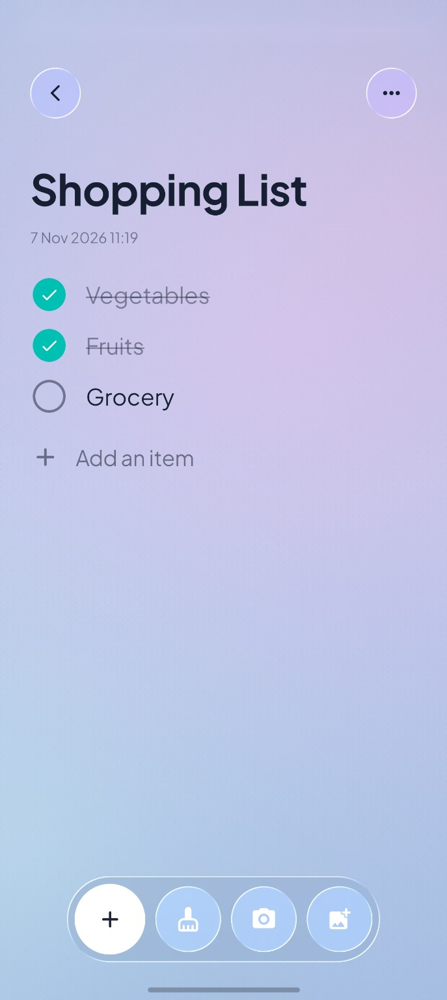
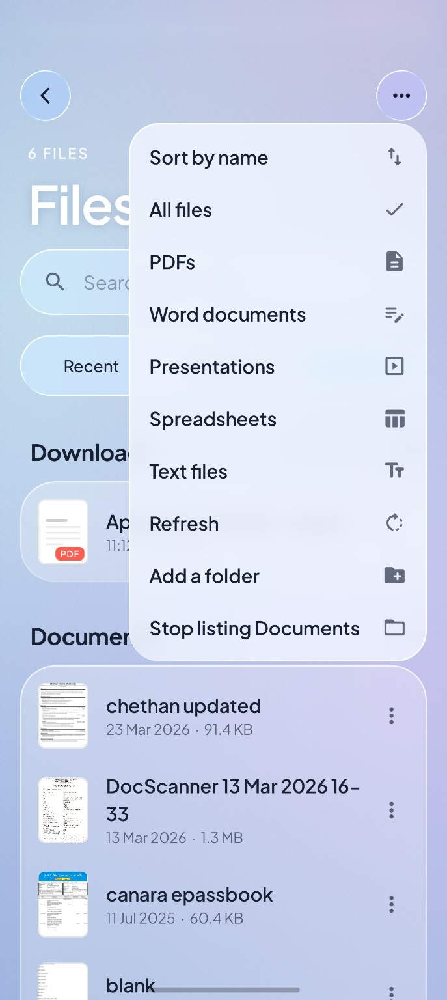
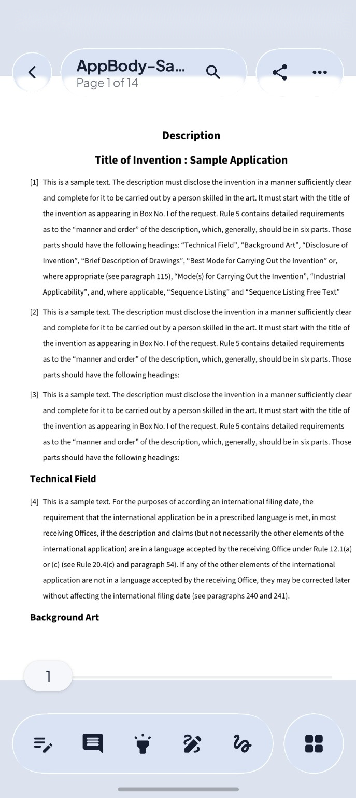
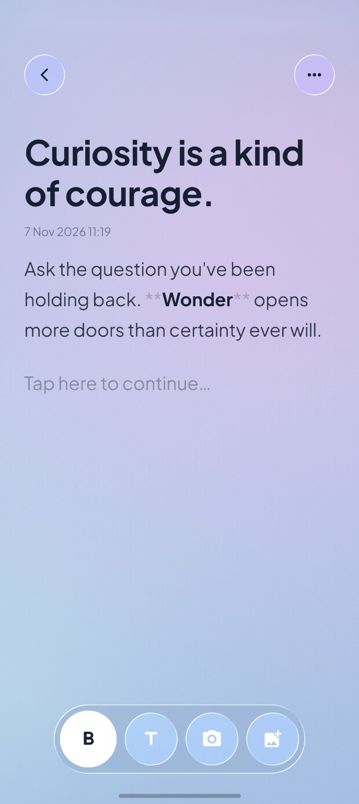
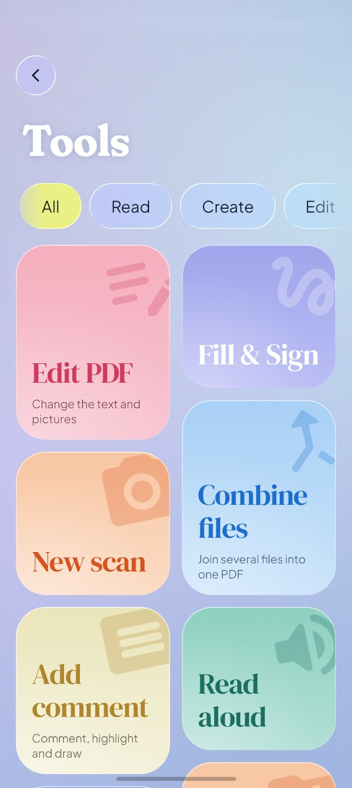

<div align="center">


# Artefact

### Free, open-source PDF reader and document editor for Android. Previously known as ClearPDF.

Read, sign and edit PDFs, open and edit Word, Excel and PowerPoint files, and keep notes, to-do and shopping lists, photos and voice memos on one liquid-glass desk. No ads, no accounts, no internet: everything stays on your phone.

<p>
  <a href="https://trendshift.io/repositories/107392?utm_source=repository-badge&utm_medium=badge&utm_campaign=badge-repository-107392" target="_blank" rel="noopener noreferrer"></a>
</p>

<p>
  <a href="https://github.com/Chethan616/ClearPDF/releases/latest"></a>
  <a href="https://apps.obtainium.imranr.dev/redirect?r=obtainium://add/https://github.com/Chethan616/ClearPDF"></a>
  <a href="https://github.com/Chethan616/ClearPDF/issues/new/choose"></a>
</p>

<p>
  <a href="https://github.com/Chethan616/ClearPDF/releases">All releases</a>
  · <a href="https://github.com/Chethan616/ClearPDF/discussions">Discussions</a>
  · <a href="CONTRIBUTING.md">Contribute</a>
  · <a href="https://github.com/sponsors/Chethan616">Sponsor</a>
</p>

<p>
  <a href="https://github.com/Chethan616/ClearPDF/stargazers"></a>
  <a href="https://github.com/Chethan616/ClearPDF/network/members"></a>
  <a href="https://github.com/Chethan616/ClearPDF/releases/latest"></a>
  <a href="https://github.com/Chethan616/ClearPDF/releases"></a>
  <a href="LICENSE-MIT"></a>
  
  
  
  <a href="https://github.com/Chethan616/ClearPDF/actions/workflows/release.yml"></a>
</p>

<h3>Watch the trailer</h3>

<p>
  <a href="docs/media/artefact-trailer-16x9.mp4"></a>
  <br>
  <sub><a href="docs/media/artefact-trailer-16x9.mp4">Trailer, 16:9 (4K 60 fps)</a> · <a href="docs/media/artefact-trailer-9x16.mp4">Vertical cut, 9:16</a></sub>
</p>

</div>

**Artefact is the next version of ClearPDF**, best known for its user experience and refined features. It installs over ClearPDF as an update and keeps your files where they are. Everything runs on your phone, on one Rust engine for PDF, Word, PowerPoint, Excel and pictures; the app has no internet permission at all.

## Featured by HowToMen

ClearPDF / Artefact was featured by HowToMen — [watch from 9:08 →](https://www.youtube.com/watch?v=TYNzg59ke30&t=548s)

## Screenshots & Demo

<p align="center">
  <a href="docs/media/artefact-demo.mp4">
    
  </a>
  <br>
  <sub>No need to open the app — tap a PDF, Word doc or spreadsheet in WhatsApp, Gmail or any app and it surfaces as a floating glass card, right over your chat. Like Apple's Quick Look on Android. Swipe up to open it fully in Artefact.</sub>
</p>

<table align="center">
  <tr>
    <td align="center"></td>
    <td align="center"></td>
    <td align="center"></td>
  </tr>
  <tr>
    <td align="center"></td>
    <td align="center"></td>
    <td align="center"></td>
  </tr>
</table>

## What you can do

### Read and work with PDFs

- Read with smooth scrolling, pinch zoom, page thumbnails, bookmarks, a reading mode and in-document search.
- Select and copy text, with a liquid-glass magnifier; read pages aloud; run on-device OCR for scanned pages.
- Highlight, underline, strike out, draw ink, add shapes, text notes and pictures; edit the PDF's own text.
- Fill forms, sign with a drawn, typed or certificate (digital-ID) signature, and verify signatures.
- Organise, rotate, crop, delete and extract pages; merge, split, compress, protect and export PDFs; create PDFs from photos, text or scans.

### Open and edit Office documents

- **Word** (.docx, .doc, .odt, .rtf, Markdown, TXT): read, search, read aloud, and edit paragraphs in place with bold, italic, lists, alignment and headings. Save as Word, OpenDocument, RTF, HTML, Markdown, TXT or PDF.
- **Excel** (.xlsx, .xls, .xlsb, .ods, .csv): a pannable grid with frozen panes and sheet tabs; type values and formulas that recalculate, format cells, insert rows and columns, find and undo. Save as Excel or CSV, or export to PDF.
- **PowerPoint** (.pptx, and text from .ppt): slides as pages, full-screen present mode, search, read aloud and export to PDF.

### Notes, lists, photos and voice

- Quick notes with light formatting, to-do and shopping lists you tick right on the desk, voice memos with a waveform, and photo notes.
- A picture editor with exposure, contrast, highlights, shadows, vibrance, saturation and rotation — the way Photos edits.
- A thought of the day to start writing from.

### Quick Preview

Open a file from WhatsApp, Gmail or a file manager and it floats over that app as a glass card, like Apple's Quick Look. Drag it up to open it in Artefact, or close it and carry on where you were.

## Supported formats

| Kind | Opens | Edits | Saves as |
|---|---|---|---|
| PDF | .pdf | text, annotations, forms, signatures, pages | PDF, images, text |
| Word | .docx .docm .dotx .doc .odt .rtf .md .txt | paragraphs and formatting | .docx .odt .rtf .html .md .txt, PDF |
| Excel | .xlsx .xlsm .xlsb .xls .ods .csv .tsv | cells, formulas, formatting, rows and columns | .xlsx .csv, PDF |
| PowerPoint | .pptx .ppsx .potx, .ppt (text only) | — | .pptx, PDF |
| Images | .png .jpg .webp .bmp .heic | crop, rotate, adjust, draw | .png .jpg |

Rendering is done by Artefact's own Rust engine — no other app or online service is needed.

## Supported Android versions

- **Android 10 (API 29) or newer** is required for Artefact.
- Artefact replaces ClearPDF as an in-place upgrade; your files and settings are kept.

## Download

<p>
  <a href="https://github.com/Chethan616/ClearPDF/releases/latest"></a>
</p>

Open the release page and download the APK that matches your device:

| APK suffix | Choose it for |
|---|---|
| `-arm64-v8a.apk` | Most current 64-bit ARM phones and tablets |
| `-armeabi-v7a.apk` | 32-bit ARM devices |
| `-x86_64.apk` | 64-bit x86 emulators and devices |
| `-x86.apk` | 32-bit x86 emulators and devices |
| `-universal.apk` | A larger package containing all supported ABIs |

The APK installs over ClearPDF and keeps your data.

### Install via Obtainium

[Obtainium](https://github.com/ImranR98/Obtainium) tracks this repository's releases and installs updates automatically.

<p>
  <a href="https://apps.obtainium.imranr.dev/redirect?r=obtainium://add/https://github.com/Chethan616/ClearPDF"></a>
</p>

Tap the badge on your phone with Obtainium installed — it opens the add-app screen pre-filled. GitHub strips raw `obtainium://` links from README buttons, so the badge goes through Obtainium's redirect page instead of linking directly.

If the badge doesn't open the app, add it manually:

1. Open Obtainium → **Add App**.
2. Paste `https://github.com/Chethan616/ClearPDF`.
3. Pick the APK suffix for your device from the table above when prompted.

### Install the latest APK via ADB

Useful for quick sideloading from a PC or emulator testing:

```bash
# 1 — download the arm64 APK from the latest release
curl -L -o artefact.apk \
  "$(curl -s https://api.github.com/repos/Chethan616/ClearPDF/releases/latest \
     | grep browser_download_url | grep arm64-v8a | cut -d '"' -f 4)"

# 2 — install over USB (or use -s <device-serial> to target a specific device)
adb install -r artefact.apk
```

On Windows (PowerShell):

```powershell
# 1 — download
$url = (Invoke-RestMethod "https://api.github.com/repos/Chethan616/ClearPDF/releases/latest").assets |
       Where-Object { $_.name -like "*arm64*" } |
       Select-Object -ExpandProperty browser_download_url
Invoke-WebRequest $url -OutFile artefact.apk

# 2 — install
adb install -r artefact.apk
```

> **Tip:** Use `adb install -r -d artefact.apk` if you are downgrading from a newer build. For emulators grab the `-x86_64.apk` instead.

## Privacy and network use

Artefact has **no internet permission** — the Android `INTERNET` permission is not declared in the manifest and cannot be granted. The app has no analytics, no ads and no account system. Your documents, notes, recordings and photos never leave your phone. See [PRIVACY.md](PRIVACY.md) for the full policy.

## Technology

- **Engine:** Rust — PDF via [PdfCraft](https://github.com/storytold/pdfcraft), Word via [WordCraft](https://github.com/storytold/wordcraft), PowerPoint via [DeckCraft](https://github.com/storytold/deckcraft), Excel via [GridCraft](https://github.com/storytold/gridcraft), images via [LightCraft](https://github.com/storytold/lightcraft). One native library, `libartefact.so`, joined to the app with [UniFFI](https://github.com/mozilla/uniffi-rs).
- **App:** Kotlin and Jetpack Compose, with liquid-glass surfaces from [AndroidLiquidGlass](https://github.com/Kyant0/AndroidLiquidGlass) and Material 3 Expressive motion.
- **Text recognition:** bundled on-device ML Kit OCR.
- **Languages:** English, Arabic, German, Spanish, French, Italian, Portuguese (Brazil and Portugal) and Russian.

## Build and run from source

### Requirements

- Android Studio with JDK 17 or newer.
- Android SDK Platform 36 and Build Tools 36.1.0.
- Android NDK (the version pinned in `engine/rust-toolchain.toml`).
- [Rust](https://rustup.rs) with [cargo-ndk](https://github.com/bbqsrc/cargo-ndk).
- An Android 10+ device or emulator.

### Build a debug APK

```bash
git clone https://github.com/Chethan616/ClearPDF.git
cd ClearPDF/android
./gradlew installDebug -Partefact.abis=arm64-v8a   # use x86_64 for an emulator
```

On Windows, run `gradlew.bat installDebug -Partefact.abis=arm64-v8a`. The build compiles the Rust engine with cargo-ndk and generates its Kotlin bindings automatically.

### Build the release APKs

```bash
./gradlew assembleRelease
```

ABI-split APKs are written under `android/app/build/outputs/apk/release/`. Release builds use local signing credentials when configured; otherwise the debug key is used. Do not distribute a debug-signed build as an official release.

### Run engine tests

```bash
cd engine
cargo test -p artefact-mobile
```

### Project layout

| Path | What it is |
|---|---|
| `android/` | The app — Kotlin, Jetpack Compose, and the liquid-glass `backdrop` module |
| `engine/` | The Rust engine: PDF crates, the mobile bridge (`engine/mobile`), patched crates (`engine/vendor`), fonts and models |
| `docs/` | Design notes and media |
| `fastlane/` | Store listings in nine languages |
| `tools/` | Developer utilities (i18n helper, etc.) |

To run from Android Studio, open the repository root, sync Gradle, and run the `app` module. ClearPDF's code and history are on the [`clearPDF`](https://github.com/Chethan616/ClearPDF/tree/clearPDF) branch.

## Contributing and support

Issues, ideas and focused pull requests are welcome.

- [Report a bug](https://github.com/Chethan616/ClearPDF/issues/new?template=bug_report.yml).
- [Request a feature](https://github.com/Chethan616/ClearPDF/issues/new?template=feature_request.yml).
- Join the conversation in [Discussions](https://github.com/Chethan616/ClearPDF/discussions).
- Read the [contribution guide](CONTRIBUTING.md) and [Code of Conduct](CODE_OF_CONDUCT.md).
- Report a security concern through [SECURITY.md](SECURITY.md).
- Review known requests and reports in [all issues](https://github.com/Chethan616/ClearPDF/issues).

If Artefact is useful to you, starring the repository helps others discover it.

## FAQ

<details>
<summary><strong>Is Artefact a free, open-source PDF reader for Android?</strong></summary>

Yes. Artefact is free and open source (MIT OR Apache-2.0), with no ads, no in-app purchases and no account required. It reads, annotates, signs and edits PDFs, and also opens and edits Word, Excel and PowerPoint files.
</details>

<details>
<summary><strong>Is ClearPDF the same app?</strong></summary>

Artefact is ClearPDF's next version, by the same developer. It updates ClearPDF in place, keeping your files and settings. ClearPDF's code stays on the [`clearPDF`](https://github.com/Chethan616/ClearPDF/tree/clearPDF) branch.
</details>

<details>
<summary><strong>Can I use Artefact offline? Does it upload my files?</strong></summary>

It works fully offline and never uploads anything. The app has no internet permission — it cannot reach the network at all. Every document is opened, edited and saved on your phone by Artefact's own engine.
</details>

<details>
<summary><strong>Can I edit Word documents and Excel spreadsheets on Android?</strong></summary>

Yes. Word paragraphs are edited in place with formatting (bold, italic, lists, headings). Spreadsheet cells take values and formulas that recalculate, with cell formatting and row/column changes. Both save in their original formats or export to PDF.
</details>

<details>
<summary><strong>Can I edit existing PDF text?</strong></summary>

Yes — Artefact can edit text already in a PDF page, in addition to annotations, form fields, signatures and page management. Word and PowerPoint files are viewed and can be exported to PDF.
</details>

<details>
<summary><strong>What Android version do I need?</strong></summary>

Android 10 (API 29) or newer.
</details>

## Credits

Artefact is built on [PdfCraft for Android](https://github.com/artcraft-android/pdfcraft-android) by the ArtCraft Team and storytold's PdfCraft, WordCraft, DeckCraft, GridCraft and LightCraft engines.

- [AndroidLiquidGlass](https://github.com/Kyant0/AndroidLiquidGlass) by Kyant0 for liquid-glass backdrop effects (Apache-2.0).
- [AndroidLiquidGlassView](https://github.com/QmDeve/AndroidLiquidGlassView) by QmDeve for motion techniques (MIT).
- [UniFFI](https://github.com/mozilla/uniffi-rs) by Mozilla for Rust–Kotlin bindings (MPL-2.0).

Every work Artefact uses, with its licence, is listed in [ATTRIBUTION.md](ATTRIBUTION.md), [NOTICE](NOTICE) and the app's **Settings ▸ Built with open source**. You can also [sponsor the project on GitHub](https://github.com/sponsors/Chethan616).

## License

Artefact is licensed under either the [MIT License](LICENSE-MIT) or the [Apache License 2.0](LICENSE-APACHE), at your option. Third-party works keep their own licences, listed in [ATTRIBUTION.md](ATTRIBUTION.md) and [NOTICE](NOTICE).
